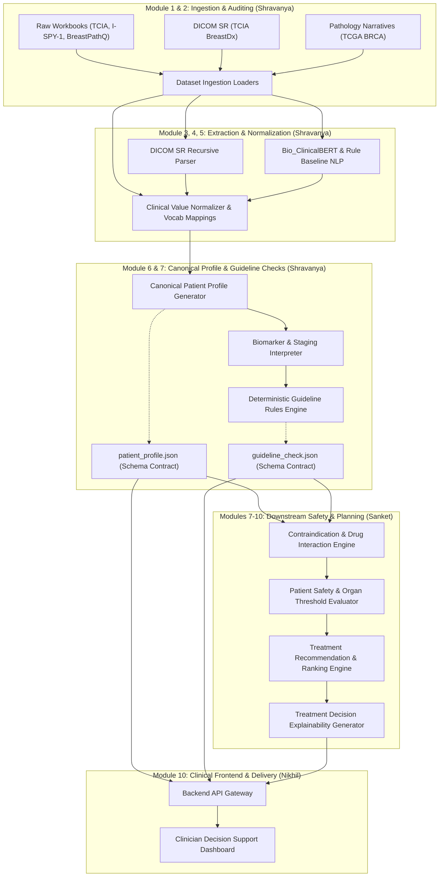

# System Architecture & Component Interfaces

## 1. System Architecture Overview

The Breast Cancer CDSS is designed as an explainable, modular pipeline with clean service boundaries. Each module communicates through strictly validated JSON schemas.



---

## 2. Integration Interface Contract 1: `patient_profile.json`

This contract is produced by Shravanya (`src/patient_profile/`) and consumed by Sanket's contraindication engine and Nikhil's UI dashboard.

### Core Structure
```json
{
  "$schema": "https://json-schema.org/draft/2020-12/schema",
  "patient_id": "string",
  "source_dataset": "string",
  "source_patient_id": "string",
  "profile_generation_timestamp": "string (ISO 8601)",
  "demographics": {
    "age": "number | null",
    "menopausal_status": "premenopausal | perimenopausal | postmenopausal | unknown",
    "status": "documented | not_reported | unknown"
  },
  "clinical_extent": {
    "laterality": "left | right | bilateral | unknown",
    "primary_tumor_size_mm": "number | null",
    "clinical_t_stage": "string",
    "clinical_n_stage": "string",
    "clinical_m_stage": "string",
    "status": "documented | not_reported | insufficient_information"
  },
  "pathology_biomarkers": {
    "histologic_type": "string",
    "histologic_grade": "grade_1 | grade_2 | grade_3 | unknown",
    "er_status": "positive | negative | equivocal | unknown",
    "er_percentage": "number | null",
    "er_low_flag": "boolean | null",
    "pr_status": "positive | negative | equivocal | unknown",
    "pr_percentage": "number | null",
    "her2_status": "positive | negative | equivocal | unknown",
    "her2_ihc_score": "0 | 1+ | 2+ | 3+ | unknown",
    "her2_fish_ratio": "number | null",
    "ki67_index": "number | null",
    "molecular_subtype": "luminal_a | luminal_b_her2_negative | luminal_b_her2_positive | her2_enriched | triple_negative | luminal_unspecified | unknown",
    "status": "documented | not_reported | equivocal"
  },
  "observations": [
    {
      "observation_id": "string (UUID)",
      "concept": "string",
      "normalized_value": "any",
      "raw_value": "string | number | null",
      "status": "documented | not_reported | not_assessed | not_available | unknown | equivocal | conflicting | not_applicable",
      "unit": "string | null",
      "timepoint": "baseline | pre_treatment | during_treatment | post_treatment_resection | outcome",
      "provenance": {
        "source_dataset": "string",
        "source_file": "string",
        "source_record_id": "string",
        "source_field_path": "string"
      },
      "extraction": {
        "method": "structured_parser | dicom_sr_parser | nlp_bio_clinicalbert | rule_regex",
        "confidence": "number | null"
      }
    }
  ]
}
```

---

## 3. Integration Interface Contract 2: `guideline_check.json`

This contract is produced by Shravanya's Guideline Rules Engine (`src/guidelines/`) and consumed by Sanket's treatment recommendation logic and Nikhil's UI.

### Core Structure
```json
{
  "$schema": "https://json-schema.org/draft/2020-12/schema",
  "patient_id": "string",
  "evaluation_timestamp": "string (ISO 8601)",
  "guideline_evaluations": [
    {
      "rule_id": "string (e.g. ISMPO-BC-2023-HER2-ADJ-001)",
      "guideline_name": "string (e.g. ISMPO Breast Cancer Practice Guidelines)",
      "guideline_version": "string (e.g. 2023 Edition)",
      "section_reference": "string (e.g. Section 4.2, p. 18)",
      "clinical_domain": "early_breast_cancer | locally_advanced | metastatic | systemic_neoadjuvant | systemic_adjuvant",
      "target_intervention": "string (e.g. Adjuvant Trastuzumab + Chemotherapy)",
      "result_status": "applicable | not_applicable | insufficient_information | requires_clinician_review | conflicting_information",
      "matched_criteria": [
        {
          "concept": "her2_status",
          "required_value": "positive",
          "actual_value": "positive",
          "status": "matched"
        },
        {
          "concept": "tumor_size_mm",
          "required_value": "> 5.0",
          "actual_value": 22.0,
          "status": "matched"
        }
      ],
      "unmatched_or_missing_criteria": [],
      "explanation": "Patient has confirmed HER2-positive invasive disease > 5mm (22 mm). Guideline recommends 1 year of adjuvant trastuzumab-based systemic therapy.",
      "clinician_action_prompt": "Confirm left ventricular ejection fraction (LVEF) prior to anthracycline/trastuzumab initiation.",
      "review_status": "validated_rule"
    }
  ]
}
```

---

## 4. Responsibility Boundaries & Non-Duplication Agreement

To avoid conflicting logic or circular dependencies:
1. **Shravanya Owns**:
   - Ingestion, validation, clinical entity extraction, parsing, canonical patient normalization, ASCO/CAP biomarker interpretation, and guideline rule checks.
   - Outputs: `patient_profile.json` and `guideline_check.json`.
2. **Sanket Owns**:
   - Contraindication filtering (drug-disease, organ dysfunction), clinical safety gates, regimen combination ranking, multi-criteria decision optimization, and treatment-specific rationale generation.
   - Sanket consumes `patient_profile.json` and `guideline_check.json` as read-only inputs. He does not re-parse raw files or re-evaluate baseline guideline checks.
3. **Nikhil Owns**:
   - UI front-end rendering, patient profile display cards, guideline compliance flags, safety alerts, and clinician interactive review controls.
   - Nikhil does not implement business logic or manipulate raw clinical records.
