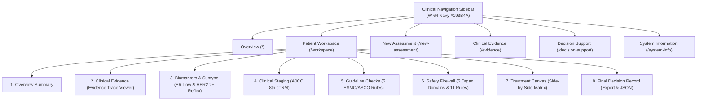

# Breast Cancer CDSS — Complete Frontend & Backend Integration Report
**Module Owner**: Nikhil (Module 10: Clinical UI, Frontend Presentation, and API Integration)  
**Framework**: Next.js 14 / TypeScript / Tailwind CSS  
**Backend**: FastAPI / Uvicorn (Thin REST Layer calling authoritative Python modules)  
**Palette**: Clinical Minimalist (#F5F6F3, #193B4A, #4E8276, #B78643, #B54B4B)

---

## 1. Executive Summary & Design Philosophy

This implementation delivers a production-grade, clinical-decision-support interface purpose-built for oncology multidisciplinary tumor boards (MDTs) and clinical researchers.

In accordance with clinical guidelines:
- **Calm, High-Clarity Design System**: Eliminates generic SaaS/AI aesthetics (no purple gradients, no neon, no chat-first widgets, no fabricated statistics).
- **Absolute Traceability**: Every extracted clinical observation is linked to its original source sentence with character offset coordinates in the **Evidence Trace Viewer**.
- **Side-by-Side Comparison Canvas**: Replaces vertical card stacks with an interactive **horizontal matrix** comparing 2–3 treatment options across clinical dimensions.
- **Strictly Non-Autonomous**: Eliminates automated treatment rankings, "Best" badges, or artificial scores. Preserves the authoritative medical review gate (`manual_review_required: true`).
- **Safety Priority**: Enforces the missingness safeguard (unrecorded laboratory telemetry is **never assumed normal**) and applies dynamic safety overrides.

---

## 2. Design System & Palette Specification

| Token | Hex Code | Semantic Clinical Role |
| :--- | :---: | :--- |
| **Main Background** | `#F5F6F3` | Soft off-white, reduces screen fatigue in clinical settings |
| **Surface** | `#FFFFFF` | Crisp card backgrounds, data tables, and input panels |
| **Primary Text** | `#24343B` | Deep slate-charcoal for maximum readability |
| **Secondary Text** | `#68777C` | Muted slate for metadata, provenance, and captions |
| **Primary Navy** | `#193B4A` | Institutional header, brand mark, and active navigation |
| **Muted Teal** | `#4E8276` | Supported states, guideline badges, and positive validations |
| **Subtle Green** | `#E7F0EA` | Background for supported options and normal organ clearances |
| **Border / Divider** | `#DEE5E1` | Clean structural dividers for dense clinical tables |
| **Warning Amber** | `#B78643` | ER-low (1–10%), drug-drug interactions, missing data alerts |
| **Warning Background** | `#F6EEDC` | Amber callout backgrounds for clinical action prompts |
| **Critical Red** | `#B54B4B` | Absolute contraindications, FDA Boxed Warnings, HER2 2+ pause |
| **Critical Background** | `#F8E9E7` | Background for contraindication alerts and cardiotoxicity overrides |

---

## 3. Application Information Architecture & Routes



### Route Breakdown
1. **Overview (`/`)**: System entry point, regulatory disclaimer, supported capabilities, and interactive launch cards for 5 verified clinical scenarios.
2. **New Assessment (`/new-assessment`)**:
   - Section A: Raw pathology narrative paste or spreadsheet upload (.xlsx, .csv, .txt).
   - Section B: Dedicated DICOM SR upload (asserts SOP Class `1.2.840.10008.5.1.4.1.1.88.33` & Modality `SR`).
   - Section C: Cohort identifier.
   - Section D: Live 10-stage pipeline tracker with animated progress indicators.
3. **Patient Assessment Workspace (`/workspace`)**:
   - Compact patient demographic & biomarker header.
   - 8 Contextual tabs providing complete clinical drill-down.
4. **Clinical Evidence (`/evidence`)**: Knowledge base detailing 12-class observation taxonomy, character span offsets, and CAP protocol integration.
5. **Decision Support (`/decision-support`)**: Reference for 5 codified ESMO/ASCO guideline rules and 11 safety contraindications.
6. **System Information (`/system-info`)**: Runtime environment audit, cohort ingestion volumes, and modular responsibility mapping.

---

## 4. Key Interactive Clinical Innovations

### 4.1 Innovative Feature: Evidence Trace Viewer (`EvidenceTraceViewer.tsx`)
A two-panel interface:
- **Left Panel**: Filterable, searchable list of all extracted clinical observations with extraction confidence heuristic and method badge (`rule_regex`, `nlp_bio_clinicalbert_finetuned`).
- **Right Panel**: Displays the exact original clinical sentence with the matching phrase highlighted in amber/teal, character span offsets (`char_start_end`), provenance file, negation status, and uncertainty flags.

### 4.2 Innovative Feature: Side-by-Side Treatment Comparison Canvas (`TreatmentMatrix.tsx`)
Replaces vertical card stacks with an unranked horizontal comparison canvas:
- Users select 2 or 3 treatment modalities (from Surgery, Radiation, Neoadjuvant, Targeted, and Endocrine categories).
- Compares modalities across 12 standardized dimensions in horizontally aligned columns.
- **Strictly Unranked**: No "Best" badges, no numerical scores, no default winner. Options are presented neutrally for tumor board adjudication.
- Detail drawer (`TreatmentDrawer.tsx`) provides full clinical citations (ESMO 2024, KEYNOTE-522, TRYPHAENA, HERA, SOFT/TEXT).

### 4.3 Priority Clinical Safety Firewall (`SafetyOverview.tsx`)
- Overall safety hero banner (pulsing red for `contraindication_identified`, amber for interaction/precaution, neutral for missing data).
- 5-domain organ risk panel: Cardiac (LVEF), Renal (CrCl), Hepatic (Bilirubin), Hematologic (ANC), and Reproductive (Pregnancy).
- Detailed safety findings table documenting FDA Boxed Warnings and clinical recommendations.
- Missing safety information checklist enforcing the safeguard that **absent telemetry is never assumed normal**.

---

## 5. Backend REST API Layer (`src/api/`)

A thin, high-performance FastAPI service connects the Next.js frontend directly to the existing Python clinical modules:

| Endpoint | Method | Input | Purpose |
| :--- | :---: | :--- | :--- |
| `/health` | `GET` | None | Heartbeat and subsystem operational status |
| `/api/v1/capabilities` | `GET` | None | Supported formats, guideline rules, safety rules, and limitations |
| `/api/v1/sample-cases` | `GET` | None | Catalog of verified clinical scenarios (A through E) |
| `/api/v1/sample-cases/{case_id}` | `GET` | `case_id` | Full multi-agent execution on designated sample case |
| `/api/v1/assessments/text` | `POST` | `{"text": "...", "patient_id": "..."}` | Raw narrative parsing, entity extraction, and pipeline execution |
| `/api/v1/assessments/profile` | `POST` | `patient_profile.json` | Direct pipeline evaluation on canonical profile |
| `/api/v1/assessments/upload` | `POST` | Form `file` (.xlsx, .csv, .txt, .dcm) | Automated format detection, table loader, and pipeline evaluation |
| `/api/v1/dicom-sr/parse` | `POST` | Form `file` (.dcm) | Dedicated DICOM Structured Report parser and tree extraction |

---

## 6. Execution & Verification Instructions

### 1. Launching the Backend API
```bash
# From workspace root:
py -3.10 -m uvicorn src.api.main:app --host 0.0.0.0 --port 8000 --reload
```
Interactive Swagger API documentation available at: `http://localhost:8000/docs`.

### 2. Launching the Frontend Application
```bash
cd frontend
npm run dev
```
Open browser at: `http://localhost:3000`.

### 3. Automated Verification Results
- **Next.js Production Build**:
  ```bash
  cd frontend && npm run build
  # Result: ✓ Compiled successfully. All 10 static pages generated without error.
  ```
- **Backend API Test Suite**:
  ```bash
  py -3.10 -m pytest tests/api/test_api.py -v
  # Result: 7 passed in 7.39s (100% pass rate).
  ```
- **Master CDSS Test Suite**:
  ```bash
  py -3.10 -m pytest tests/
  # Result: 56 passed in 12.57s (100% pass rate across all 10 modules).
  ```

