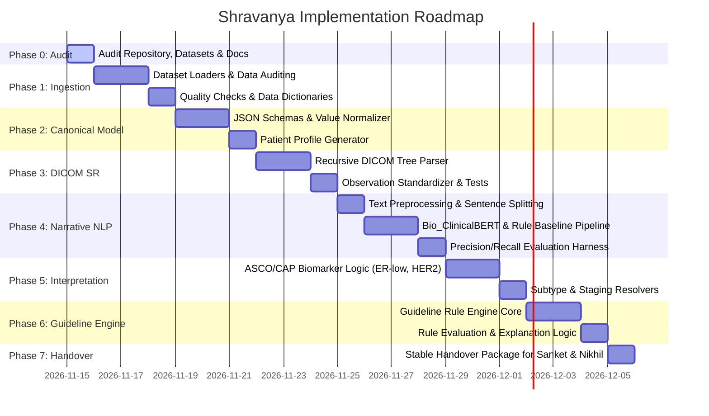

# Shravanya's Master Implementation Plan

## 1. Plan Overview & Governance

This document outlines the ordered implementation roadmap for the modules assigned to Shravanya (Modules 1 through 7). Work follows a strict phased execution strategy where each milestone requires code implementation, unit testing, documentation update, and verified Git commits.

---

## 2. Phased Roadmap

---

## 3. Detailed Phase Breakdown

### Phase 0: Repository & Research Audit (CURRENT PHASE)
- **Status**: Completed / Pending User Review.
- **Objectives**:
  - Audit existing workspace, Git status, directory layout, and uploaded files.
  - Inspect actual raw files (sheets, columns, rows, nulls, unique patient counts).
  - Verify research methodology and establish strict clinical guardrails.
  - Deliver comprehensive foundational documentation in `docs/`.
- **Deliverables**:
  - `docs/PROJECT_CONTEXT.md`
  - `docs/DATASET_INVENTORY.md`
  - `docs/RESEARCH_METHODOLOGY.md`
  - `docs/MASTER_DATA_DICTIONARY.md`
  - `docs/ARCHITECTURE_AND_INTERFACES.md`
  - `docs/IMPLEMENTATION_PLAN_SHRAVANYA.md`
  - `docs/DECISION_LOG.md`
  - `docs/IMPLEMENTATION_LOG.md`
  - `docs/HANDOVER_SHRAVANYA.md`
  - `docs/KNOWN_LIMITATIONS.md`
  - `docs/SESSION_HANDOVER.md`

### Phase 1: Data Organization & Ingestion Pipelines
- **Dependencies**: Phase 0 completion.
- **Objectives**:
  - Implement modular, reproducible dataset ingestion loaders in `src/ingestion/`:
    - `tcia_breast_diagnosis_loader.py` (handles matrix transposition into patient rows).
    - `ispy1_loader.py` (ingests clinical subset, enforces baseline/outcome separation).
    - `breastpathq_loader.py` (preserves scan/patient linkage, separates post-NAT resection data).
    - `tcga_brca_loader.py` (filters verified 1,034 TCGA-BRCA cohort).
  - Implement automated dataset validation scripts and quality assertion reports.
- **Deliverables**:
  - `src/ingestion/`
  - `tests/ingestion/`
  - `docs/DATA_LOADING.md`
  - `docs/DATA_QUALITY_REPORT.md`

### Phase 2: Preprocessing & Canonical Data Model
- **Dependencies**: Phase 1 ingestion loaders.
- **Objectives**:
  - Create and register JSON schema specifications:
    - `schemas/patient_profile.schema.json`
    - `schemas/clinical_observation.schema.json`
  - Build clinical value normalizer (`src/preprocessing/`):
    - Categorical harmonizers (ER, PR, HER2, Grade, Histology, Laterality).
    - Measurement and unit normalizers (mm, %, scores).
    - Provenance envelope attachment for every observation.
  - Implement `src/patient_profile/generator.py` to produce consolidated patient JSON documents without cohort contamination.
- **Deliverables**:
  - `schemas/`
  - `src/preprocessing/`
  - `src/patient_profile/`
  - `tests/patient_profile/`

### Phase 3: Reusable DICOM Structured Report (SR) Parser
- **Dependencies**: `pydicom` integration.
- **Objectives**:
  - Build `src/dicom/sr_parser.py`:
    - Recursive ContentSequence tree walker.
    - Identification of SOP Class UID (`1.2.840.10008.5.1.4.1.1.88.33`) and template structure.
    - Concept Code sequence decoding (`CodeValue`, `CodingSchemeDesignator`, `CodeMeaning`).
    - Measurement extraction (`NUM` with `MeasuredValueSequence` and units).
    - Qualitative assessment extraction (`CODE`, `TEXT`).
  - Standardize findings into canonical `clinical_observation` objects.
  - Test across all 94 `.dcm` files in the TCIA Breast-Diagnosis cohort.
- **Deliverables**:
  - `src/dicom/`
  - `tests/dicom/`
  - `docs/DICOM_SR_PARSER.md`

### Phase 4: Bio_ClinicalBERT Narrative NLP Pipeline
- **Dependencies**: Hugging Face `transformers`, `torch`, verified TCGA-BRCA corpus.
- **Objectives**:
  - Construct NLP pipeline (`src/nlp/`):
    - Clinical narrative text cleaner preserving negation and hedging tokens.
    - Domain-aware sentence segmenter.
    - Clinical entity recognizer targeting ER, PR, HER2, Grade, Histology, and nodal findings.
    - Negation / uncertainty resolution (e.g., "no evidence of axillary metastasis", "equivocal HER2 staining").
  - Build deterministic regex/rule baseline to provide a benchmark comparison.
  - Implement evaluation harness computing Precision, Recall, and F1 on annotated samples.
- **Deliverables**:
  - `src/nlp/`
  - `tests/nlp/`
  - `docs/NLP_METHODOLOGY.md`
  - `docs/NLP_EVALUATION.md`

### Phase 5: Biomarker Interpretation & Staging-Related Assessment
- **Dependencies**: Phase 2 canonical profiles.
- **Objectives**:
  - Implement validated clinical logic in `src/clinical_interpretation/`:
    - `biomarker_interpreter.py`: ASCO/CAP 2018/2020 ER/PR and HER2 interpretation (explicit ER-low 1–10%, HER2 2+ equivocal logic).
    - `molecular_subtype.py`: Surrogate intrinsic subtype determination (Luminal A, Luminal B HER2-, Luminal B HER2+, HER2-Enriched, Triple-Negative) with missingness alerts.
    - `staging_assessor.py`: AJCC 8th edition clinical extent classification (cT, cN, cM) avoiding imputation of unassessed staging parameters.
- **Deliverables**:
  - `src/clinical_interpretation/`
  - `tests/clinical_interpretation/`
  - `docs/BIOMARKER_RULES.md`
  - `docs/STAGING_RULES.md`

### Phase 6: Guideline Knowledge Base & Evaluation Engine
- **Dependencies**: Phase 5 interpretation outputs.
- **Objectives**:
  - Implement `src/guidelines/`:
    - Guideline rule schema: `schemas/guideline_check.schema.json`.
    - Version-controlled guideline rules registry (ISMPO / St. Gallen / NCCN criteria).
    - Deterministic evaluation engine executing rule criteria against patient profiles.
    - Status evaluation (`applicable`, `not_applicable`, `insufficient_information`, `requires_clinician_review`, `conflicting_information`).
    - Transparent clinician explanation and citation trail generation.
- **Deliverables**:
  - `src/guidelines/`
  - `tests/guidelines/`
  - `docs/GUIDELINE_KNOWLEDGE_BASE.md`
  - `docs/GUIDELINE_RULE_REGISTER.md`

### Phase 7: Integration & Handover Package
- **Dependencies**: All preceding phases.
- **Objectives**:
  - Package stable, versioned schemas and mock/sample outputs for Sanket and Nikhil:
    - Sample canonical `patient_profile.json` instances.
    - Sample evaluated `guideline_check.json` instances.
    - API interface specifications and Python import endpoints.
  - End-to-end integration test suite verifying end-to-end schema compliance and data integrity.
- **Deliverables**:
  - `docs/HANDOVER_SHRAVANYA.md`
  - Sample test data fixtures in `data/sample/`
  - Master test execution report.
