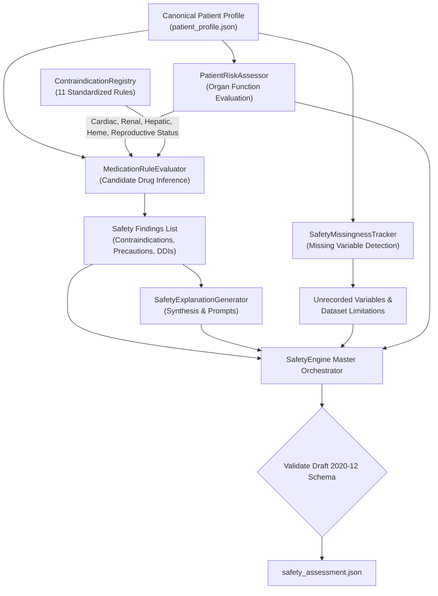

# Clinical Safety & Contraindication Engine — System Architecture & Design
**Module Owner**: Sanket Patil (`sanketp09`)  
**Role**: Senior Clinical Software Engineer & Clinical Backend Architect  
**Component**: `src/safety/`  
**Schema Contract**: `schemas/safety_assessment.schema.json` (JSON Schema Draft 2020-12)

---

## 1. Clinical Context & Non-Autonomous Posture

In breast medical oncology, therapeutic efficacy must always be balanced against acute and cumulative organ toxicities, patient comorbidities, pharmacogenomic interactions, and reproductive safety. Therapeutic regimens frequently incorporate cytotoxic anthracyclines, anti-HER2 monoclonal antibodies, taxanes, platinum salts, immune checkpoint inhibitors, and endocrine modulators—all possessing well-documented toxicities and FDA Boxed Warnings.

The **Clinical Safety & Contraindication Engine** acts as an automated safety firewall within the Breast Cancer Clinical Decision Support System (CDSS). It evaluates incoming canonical patient profiles (`patient_profile.json` produced by Shravanya's pipeline) against standardized clinical safety rules, organ function benchmarks, concomitant medication interactions, and documented contraindications.

### Core Architectural Principles
1. **Clinician-in-the-Loop Decision Support**: The safety engine evaluates safety risks and flags concerns; it **never** autonomously prescribes, alters doses, or replaces the clinical judgment of an attending medical oncologist or multidisciplinary tumor board (MDT).
2. **Deterministic & Evidence-Based**: Safety rules are derived directly from FDA package inserts, Boxed Warnings, ASCO/ESMO clinical practice guidelines, and landmark clinical trials. Rules are fully deterministic, transparent, and auditable.
3. **No Hallucination of Normalcy (Missingness Safeguard)**: Missing laboratory values, unrecorded cardiac telemetry, or unrecorded concomitant medications are **never** assumed to be normal or negative. If key variables are absent, the engine explicitly catalogs them under `missing_safety_information`, transitions the status to `insufficient_information`, and mandates clinician verification (`manual_review_required: true`).
4. **Strict Schema Conformance**: All safety outputs strictly validate against `schemas/safety_assessment.schema.json` under JSON Schema Draft 2020-12.

---

## 2. Safety Engine Architecture

The safety subsystem is organized under `src/safety/` as an extensible, modular pipeline:

```
src/safety/
├── __init__.py                      # Package exports (SafetyEngine, Registries, Evaluators)
├── contraindication_registry.py    # Standardized clinical safety rules & FDA Boxed Warnings
├── patient_risk_assessment.py       # Organ function evaluator (cardiac, renal, hepatic, heme, pregnancy)
├── medication_rules.py              # Drug-specific rules and contraindication matching engine
├── missing_information.py           # Missing safety variable detector and dataset limitations catalog
├── safety_explanation.py            # Clinical rationale generator & clinician prompt builder
└── safety_engine.py                 # Master orchestrator producing safety_assessment.json
```



---

## 3. Subsystem Components

### 3.1 Organ Function Risk Assessor (`patient_risk_assessment.py`)
Assesses five vital physiological domains prior to systemic therapy:
- **Cardiac Function**: Evaluates Left Ventricular Ejection Fraction (LVEF) from baseline echocardiograms or MUGA scans. Normal: $\ge 50\%$. Moderate dysfunction: $40\text{--}49\%$. Severe dysfunction / heart failure: $< 40\%$.
- **Renal Function**: Evaluates estimated Creatinine Clearance ($\text{CrCl}$ in $\text{mL/min}$) or serum creatinine. Identifies severe impairment ($\text{CrCl} < 30\text{ mL/min}$) and moderate impairment ($\text{CrCl} < 50\text{ mL/min}$) which preclude or require dose modifications for cisplatin/carboplatin.
- **Hepatic Function**: Evaluates serum total bilirubin and transaminases (AST/ALT). Identifies hyperbilirubinemia or hepatic cirrhosis which impairs biliary excretion of anthracyclines and taxanes.
- **Hematologic Function**: Evaluates Absolute Neutrophil Count (ANC) and platelet count. Identifies pre-existing severe neutropenia ($\text{ANC} < 1,500/\mu\text{L}$) or thrombocytopenia ($< 100,000/\mu\text{L}$) that elevate sepsis risk during cytotoxic chemotherapy.
- **Reproductive & Pregnancy Status**: Evaluates pregnancy status in women of childbearing potential. Confirmed pregnancy represents an absolute contraindication to cytotoxic chemotherapy, targeted therapy, and radiation in early gestation due to severe teratogenicity.

### 3.2 Contraindication Registry (`contraindication_registry.py`)
Houses 11 codified clinical rules mapped to standard drug classes:
1. `CONTRA-CARD-HER2-001`: Trastuzumab/Pertuzumab cardiotoxicity (LVEF $< 50\%$).
2. `CONTRA-CARD-ANTHRA-002`: Anthracycline cardiotoxicity (LVEF $< 50\%$ or prior cumulative doxorubicin $> 450\text{ mg/m}^2$).
3. `CONTRA-THROMB-TAM-003`: Tamoxifen in patients with history of Deep Vein Thrombosis (DVT) or Pulmonary Embolism (PE).
4. `DDI-CYP2D6-TAM-004`: Tamoxifen co-administration with strong CYP2D6 inhibitors (Fluoxetine, Paroxetine, Bupropion).
5. `CONTRA-ENDO-AI-PREMENO-005`: Aromatase inhibitors monotherapy in premenopausal women without GnRH ovarian function suppression.
6. `CONTRA-NEURO-TAXANE-006`: Taxane administration in baseline $\ge \text{Grade } 2$ peripheral neuropathy.
7. `CONTRA-HEME-TAX-NEUTR-007`: Myelosuppressive chemotherapy in baseline $\text{ANC} < 1,500/\mu\text{L}$.
8. `CONTRA-RENAL-PLATINUM-008`: Cisplatin/Carboplatin nephrotoxicity in renal impairment ($\text{CrCl} < 50\text{ mL/min}$).
9. `CONTRA-HEPATIC-ANTHRA-009`: Doxorubicin biliary clearance in severe hepatic impairment (Bilirubin $> 3.0\text{ mg/dL}$).
10. `CONTRA-PREG-TERATOGEN-010`: Cytotoxic, HER2-targeted, and endocrine agents during pregnancy (FDA Category D/X teratogenicity).
11. `PRECAUTION-IMMUNE-PEMBRO-011`: Pembrolizumab in active severe autoimmune disease (enteritis, myasthenia gravis, lupus).

### 3.3 Missingness Tracker & Dataset Limitation Auditing (`missing_information.py`)
Tracks missing clinical variables across retrospective research datasets (TCIA Breast-Diagnosis, I-SPY-1, TCGA-BRCA, BreastPathQ). These datasets provide pathology and imaging reports but systematically omit ambulatory prescription logs, serial cardiac telemetry, and complete metabolic panels.

The tracker catalogs:
- Missing critical lab parameters (`lvef_percent`, `creatinine_clearance`, `absolute_neutrophil_count`, `serum_bilirubin`, `pregnancy_status`).
- Concomitant medication reconciliation status.
- Source dataset auditing caveats to prevent unsafe over-interpretation.

### 3.4 Medication Rules Evaluator (`medication_rules.py`)
Inspects candidate drug classes (inferred from patient receptor status or explicitly submitted by the user) and matches patient observations against contraindications and drug interactions. Generates structured findings with:
- `finding_id`
- `safety_category` (`absolute_contraindication`, `relative_contraindication`, `black_box_warning`, `drug_interaction`, `precaution`, `organ_toxicity_risk`)
- `medication_or_class`
- `severity` (`critical`, `major`, `moderate`)
- `triggering_condition` & `explanation`
- `clinician_recommendation`
- `evidence_source` & `fda_boxed_warning` flag

### 3.5 Master Orchestrator (`safety_engine.py`)
Integrates all modules, calculates overall safety status:
- `contraindication_identified`: Absolute contraindication or FDA boxed warning breached.
- `potential_interaction`: Major drug-drug interaction detected (e.g. Tamoxifen + Fluoxetine).
- `precaution_identified`: Organ toxicity risk or relative contraindication identified.
- `insufficient_information`: Critical parameters missing in retrospective data.
- `no_identified_issue_in_available_data`: Available observations reviewed with no safety flags.

Validates the completed payload against `schemas/safety_assessment.schema.json`.

---

## 4. Verification and Contract Output

The safety engine emits a JSON document satisfying all JSON Schema Draft 2020-12 requirements:

```json
{
  "patient_id": "SCENARIO_A_LUMINAL_A",
  "assessment_timestamp": "2026-11-15T15:00:00Z",
  "upstream_profile_version": "2026-11-15T12:00:00Z",
  "overall_safety_status": "insufficient_information",
  "manual_review_required": true,
  "safety_findings": [],
  "organ_function_assessments": {
    "cardiac_function": { "status": "not_assessed", "lvef_percent": null, "risk_category": "unknown_risk", ... },
    "renal_function": { "status": "not_assessed", "creatinine_clearance_ml_min": null, ... },
    "hepatic_function": { "status": "not_assessed", ... },
    "hematologic_function": { "status": "not_assessed", ... },
    "reproductive_status": { "status": "documented", "menopausal_status": "postmenopausal", ... }
  },
  "missing_safety_information": [ ... ],
  "dataset_limitations": [ ... ]
}
```

The output seamlessly feeds into Sanket's Treatment Planning Engine (`treatment_engine.py`) and Nikhil's frontend user interface.
