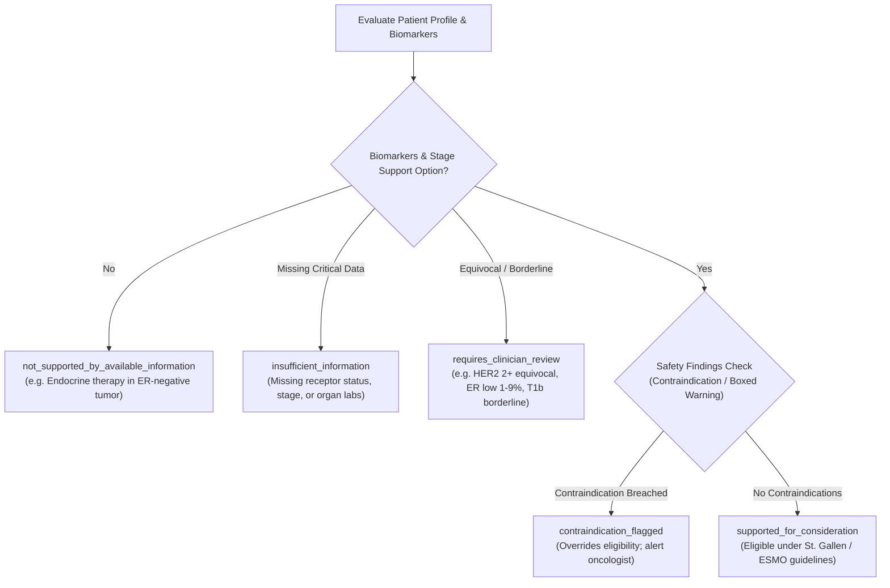

# Treatment Planning & Clinical Reasoning Methodology
**Module Owner**: Sanket Patil (`sanketp09`)  
**Role**: Senior Clinical Software Engineer & Clinical Backend Architect  
**Component**: `src/treatment/`  
**Schema Contract**: `schemas/treatment_plan.schema.json` (JSON Schema Draft 2020-12)

---

## 1. Multidisciplinary Decision Support Philosophy

Modern breast cancer management is multimodal, requiring coordinated decision-making across surgical oncology, radiation oncology, medical oncology, pathology, and medical genetics. The **Treatment Planning Engine** (`src/treatment/`) synthesizes patient demographics, anatomic stage, molecular biomarkers, guideline evaluations, and clinical safety findings into an explainable, structured treatment plan.

### Core Tenets
1. **Non-Autonomous Decision Support**: The engine assists multidisciplinary tumor boards (MDT) and practicing oncologists; it **never** autonomously prescribes or dispenses therapy.
2. **Explainable Rationale**: Every treatment option is linked to its biological rationale, supporting pathology observations, referenced guideline rules, safety constraints, and literature citations.
3. **Multimodal Evaluation**: Rather than outputting a single drug, the engine generates an integrated locoregional (surgical and radiation) and systemic (neoadjuvant, adjuvant, endocrine, and targeted) regimen plan.
4. **Mandatory Review Gate**: Every output payload contains `manual_review_required: true`.

---

## 2. Decision Support States Taxonomy

The engine classifies each evaluated treatment modality into one of five standardized decision-support states:



### Definitions:
- `supported_for_consideration`: Modality is biologically indicated by tumor characteristics, confirmed by guideline consensus, and free of documented contraindications.
- `requires_clinician_review`: Modality has biological relevance but involves borderline findings (e.g. HER2 IHC 2+ pending FISH, ER low 1–9%, T1b borderline tumor) requiring clinical tumor board adjudication.
- `contraindication_flagged`: Modality is biologically indicated, but a documented contraindication or FDA boxed warning was identified, overriding selection and mandating alternative therapy.
- `insufficient_information`: Critical parameters (e.g. staging or receptor expression) are missing from input records, preventing definitive evaluation.
- `not_supported_by_available_information`: Modality is not indicated for the patient's stage or subtype (e.g. anti-HER2 therapy in HER2-negative cancer).

---

## 3. Treatment Modality Catalog & Clinical Rules

The engine maintains eight standard treatment templates covering the full continuum of early and locally advanced breast cancer care:

### 3.1 Surgical Locoregional Options
1. **Breast-Conserving Surgery (BCS / Lumpectomy) + Sentinel Lymph Node Biopsy (SLNB)**:
   - *Eligibility*: Early unifocal disease ($\text{cT1-T2}$), favorable tumor-to-breast ratio, absence of extensive microcalcifications, patient willing and medically eligible to undergo radiation therapy.
   - *Guideline Reference*: ESMO 2024 Locoregional Management.
2. **Total Mastectomy with SLNB / Axillary Lymph Node Dissection (ALND)**:
   - *Eligibility*: Multicentric disease, inflammatory carcinoma, tumor recurrence after previous radiation, absolute contraindication to radiation therapy, or patient preference.
   - *Guideline Reference*: ESMO 2024 Locoregional Management.

### 3.2 Locoregional Radiation Therapy
3. **Moderately Hypofractionated Whole Breast Radiotherapy (WBRT)**:
   - *Eligibility*: Indicated for all patients undergoing Breast-Conserving Surgery. Recommended regimen: $40\text{ Gy}$ in $15$ fractions or ultra-hypofractionated $26\text{ Gy}$ in $5$ fractions. Boost to tumor bed considered for high-risk patients (age $< 50$ or high grade).
   - *Guideline Reference*: ESMO 2024 Radiotherapy Consensus.

### 3.3 Neoadjuvant Systemic Therapy
4. **TCHP Regimen (Docetaxel + Carboplatin + Trastuzumab + Pertuzumab)**:
   - *Eligibility*: HER2-positive early breast cancer, tumor size $> 20\text{ mm}$ ($\text{cT2-T4}$) or node-positive ($\text{cN1-N3}$). Administered for 6 cycles prior to definitive surgery.
   - *Clinical Evidence*: CLEOPATRA, TRYPHAENA, ESMO 2024.
5. **Keynote-522 Regimen (Pembrolizumab + Carboplatin + Paclitaxel $\rightarrow$ AC)**:
   - *Eligibility*: Triple-Negative Breast Cancer (TNBC), tumor size $> 20\text{ mm}$ or node-positive. Neoadjuvant immunotherapy combined with platinum/taxane and anthracycline/cyclophosphamide.
   - *Clinical Evidence*: KEYNOTE-522 Trial, FDA Approval 2021, ESMO 2024.

### 3.4 Adjuvant Systemic & Endocrine Therapy
6. **Adjuvant Trastuzumab**:
   - *Eligibility*: HER2-positive early breast cancer with tumor $> 5\text{ mm}$ ($\text{cT1b-T4}$) or node-positive. Administered every 3 weeks to complete 1 full year ($18$ cycles).
   - *Safety Constraint*: Requires baseline and serial LVEF monitoring $\ge 50\%$.
   - *Clinical Evidence*: HERA, NCCTG N9831, BCIRG 006, ESMO 2024.
7. **Aromatase Inhibitors (Anastrozole 1 mg daily or Letrozole 2.5 mg daily)**:
   - *Eligibility*: Hormone Receptor-positive ($\text{ER}^+$ and/or $\text{PR}^+$) disease.
   - *Menopausal Gating*: Postmenopausal women or premenopausal women receiving concurrent Ovarian Function Suppression (OFS).
   - *Clinical Evidence*: ATAC, BIG 1-98, EBCTCG Meta-analysis, ESMO 2024.
8. **Tamoxifen (20 mg daily for 5-10 years)**:
   - *Eligibility*: Hormone Receptor-positive disease in premenopausal or postmenopausal women.
   - *Safety Constraints*: Documented DVT/PE history contraindicates; strong CYP2D6 inhibitors must be avoided.
   - *Clinical Evidence*: EBCTCG 2011, ATLAS, aTTom, ESMO 2024.

---

## 4. Multi-Agent Reasoning Flow & Safety Synthesis

The treatment planning pipeline synthesizes findings from Shravanya's and Sanket's modules through a three-stage reasoning process:

```
┌─────────────────────────────────────────────────────────────────────────┐
│ Stage 1: Biomarker & Anatomic Stage Eligibility Assessment             │
│ - Evaluates ER, PR, HER2 IHC/FISH, Ki-67, and TNM stage.               │
│ - Identifies candidate templates matching patient biology.             │
│ - Emits baseline eligibility status.                                    │
└────────────────────────────────────┬────────────────────────────────────┘
                                     │
                                     ▼
┌─────────────────────────────────────────────────────────────────────────┐
│ Stage 2: Guideline Alignment & Equivocal Guardrails                    │
│ - Cross-references Shravanya's Guideline Evaluator results.             │
│ - Pauses options to 'requires_clinician_review' if HER2 IHC 2+ reflex   │
│   FISH is pending or ER expression is low (1-9%).                       │
└────────────────────────────────────┬────────────────────────────────────┘
                                     │
                                     ▼
┌─────────────────────────────────────────────────────────────────────────┐
│ Stage 3: Clinical Safety Override & Contraindication Enforcement        │
│ - Cross-references Sanket's Safety Engine findings.                    │
│ - Checks candidate drug classes against contraindications & DDIs.       │
│ - Overrides eligibility to 'contraindication_flagged' if an absolute    │
│   contraindication or Boxed Warning is violated.                       │
│ - Injects clinician action prompts and alternative strategies.          │
└────────────────────────────────────┬────────────────────────────────────┘
                                     │
                                     ▼
┌─────────────────────────────────────────────────────────────────────────┐
│ Stage 4: Multi-Option Synthesis & Structured Output                     │
│ - Calculates aggregate plan status (supported, review, flagged).        │
│ - Generates plain-text clinical explanation for Tumor Board.            │
│ - Validates output schema against schemas/treatment_plan.schema.json.   │
└─────────────────────────────────────────────────────────────────────────┘
```

---

## 5. Clinician Action Prompts & Explainability

To ensure explainability, every treatment option payload includes actionable clinical prompts:

```json
{
  "treatment_option_id": "OPT-ADJ-HER2-TRAST-006",
  "treatment_category": "targeted_biotherapy",
  "regimen_or_modality": "Adjuvant Trastuzumab (every 3 weeks to complete 1 full year)",
  "clinical_intent": "risk_reduction_recurrence",
  "eligibility_status": "contraindication_flagged",
  "supporting_observations": ["HER2: positive (IHC 3+)"],
  "supporting_guideline_rules": ["ESMO-BC-2024-HER2-ADJ-001"],
  "safety_findings": [
    "FIND-001: [ABSOLUTE_CONTRAINDICATION] Left Ventricular Ejection Fraction (LVEF) is 42.0%, below the required 50% safety threshold."
  ],
  "missing_information": [],
  "rationale": "Option is biologically indicated by tumor characteristics, but CONTRAINDICATION FLAGGED due to documented safety risks. Requires multidisciplinary tumor board review.",
  "clinician_action_prompts": [
    "CONTRAINDICATION: Withhold HER2-targeted monoclonal antibodies. Repeat echocardiogram in 4 weeks. Refer to cardio-oncology."
  ],
  "evidence_source": {
    "guideline_body": "ESMO Clinical Practice Guidelines 2024",
    "primary_reference": "Loibl S, et al. Early breast cancer: ESMO Clinical Practice Guideline for diagnosis, treatment and follow-up. Ann Oncol. 2024.",
    "level_of_evidence": "Level I, Grade A",
    "fda_boxed_warning": true
  },
  "manual_review_required": true
}
```

This structure guarantees that attending oncologists and tumor board members can immediately identify *why* a regimen was considered, *why* it was flagged, and *what* clinical next steps are recommended.

